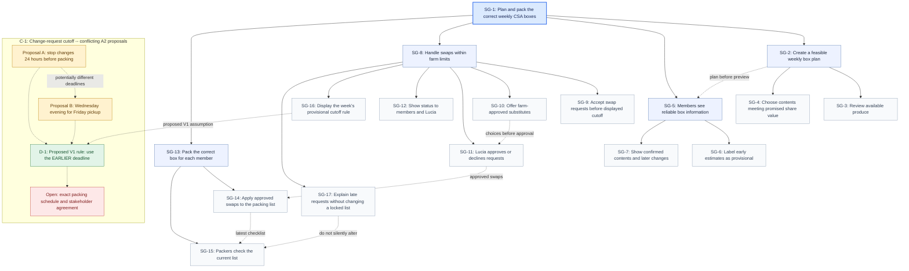

# Sprint Goal Model (V1)

> Status: **proposed group model** for the V1 sprint. Scope and decision D-1 are pending group
> sign-off. Source of truth for the diagram: [`goalmodel/goal_model_sprint.mmd`](goalmodel/goal_model_sprint.mmd)
> (generated by [`goalmodel/goal_model_sprint.py`](goalmodel/goal_model_sprint.py)).

## 1. Diagram

Solid arrows are refinements (parent → sub-goal). Dotted arrows are dependencies or the conflict
and decision links.

## 2. Sprint scope

The sprint covers one end-to-end workflow: **plan a box → publish contents → handle a member swap →
update and check the packing list**.

| Goal | Priority criterion | Why it is in scope |
|---|---|---|
| SG-2 Create a feasible weekly box plan | **Core** | Nothing can be published, swapped or packed without a plan. |
| SG-5 Members see reliable box information | **User-facing** | The member (Raj) needs dependable information before pickup. |
| SG-8 Handle swaps within farm limits | **Uncertain** | Stakeholders disagree on which changes are practical and when to stop accepting them. |
| SG-13 Pack the correct box for each member | **Core** | An approved swap only matters if it reaches the physical box. |

### Out of scope (recorded, not built)

| Need | Reason deferred |
|---|---|
| Restaurant ordering | Separate customer channel; not needed to test the CSA workflow. |
| Market sales | Separate sales channel; no dependency from the selected goals. |
| Offline synchronization | Infrastructure concern; the prototype uses mock data only. |
| Detailed lot-traceability reports | Reporting feature; not needed to validate box planning or swaps. |
| Allergen / cross-contact guarantees | Mock item data cannot support a safety claim (Constitution VII). |

## 3. Agents (responsibility)

| Agent | Type | Responsible for |
|---|---|---|
| Lucia (farm planner) | Environment | SG-3, SG-4, SG-11 |
| CSA member (e.g., Raj) | Environment | SG-9 (submitting a request) |
| Packing crew | Environment | SG-15 |
| CSA prototype | Software-to-be | SG-6, SG-7, SG-10, SG-12, SG-14, SG-16, SG-17 |

## 4. Crosswalk: SG goals → Assignment 2 goal IDs

Each team member's A2 model reused G-1, G-2, …, so the group model uses new `SG-` IDs. The mapping
is at the level of the parent goals and is approximate ("covers similar intent"), not an assertion
that the source goals are identical.

| SG goal | Member 1 model | Member 2 model (detailed catalogue) | Member 3 model (smaller graph) |
|---|---|---|---|
| SG-2 Feasible weekly box plan | G-27, G-29 | G-2 | G-13, G-17 |
| SG-5 Reliable box information | G-42, G-56, G-58, G-59 | G-40, G-41, G-42, G-43 | — |
| SG-8 Swaps within farm limits | G-60, G-62, G-63 | G-46, G-47, G-49, G-93, G-94 | G-19, G-32 |
| SG-13 Correct box packed | G-31, G-32, G-33, G-34 | G-11, G-20 | G-20, G-24 |
| SG-16, SG-17 | — | — | — (added during Step 2; see §7) |

TODO(group): replace "Member 1/2/3" with names, and confirm the leaf-level mappings.

## 5. How the source models were merged

- **Different detail on the same need**: Member 1 separated early estimates from final contents
  (→ SG-6, SG-7) and linked approved swaps to packing (→ SG-14). Member 2 added farm-approved
  substitutes, confirmations and a proposed cutoff (→ SG-10, Proposal A). Member 3 emphasized
  request status for both Lucia and members (→ SG-12) and recorded a different notice period
  (→ Proposal B).
- **Same intent, different wording**: merged into one SG goal rather than treated as separate
  features.

## 6. Goal relationships

| ID | Type | Goals | Relationship | Decision |
|---|---|---|---|---|
| R-1 | Overlap | SG-6 vs SG-7 | Both show box contents to members, but for different purposes (early estimate vs confirmed list). | **Keep separate.** Merging would hide the difference between provisional and confirmed information that SG-5 depends on. |
| R-2 | Overlap | SG-9, SG-11, SG-12, SG-14 | Request, approval, status and packing update all concern the same swap. | **Keep as separate steps of one workflow**, each with a different responsible agent. |
| R-3 | Dependency | SG-2 → SG-5 | A preview cannot be shown until a plan exists. | Build planning first; the member view reads from the plan. |
| R-4 | Dependency | SG-10 → SG-11 | Lucia can only approve swaps to farm-approved substitutes. | Members choose only from the approved list; free-text requests are not supported in V1. |
| R-5 | Dependency | SG-11 → SG-14 → SG-15 | Only approved swaps change the packing list, and packers check the latest list. | Packing list is derived from the plan plus approved swaps. |
| R-6 | Conflict / constraint | SG-17 ⟂ SG-15 | Accepting late requests would change a list packers may already be using. | Late requests are explained to the member and **do not** alter a locked list. |
| C-1 | Conflict | SG-9 / SG-16 | Proposal A: stop changes 24 h before packing. Proposal B: Wednesday evening for Friday pickup. | See D-1. Both proposals stay in the model. |

### D-1: Provisional V1 cutoff rule (compromise, pending stakeholder clarification)

- **Rule**: use the **earlier** of the two proposed deadlines.
- **Why**: the earlier deadline protects packing (SG-13) under either proposal. A later deadline
  risks changes arriving after packing starts.
- **Cost**: members get less time to request swaps than Proposal B would allow.
- **V1 assumption** (not stakeholder-confirmed): pickup is Friday and packing starts
  **Thursday 08:00**. Proposal A = Wednesday 08:00; Proposal B = Wednesday 20:00. The earlier is
  **Wednesday 08:00**.
- **Display**: the prototype labels this cutoff as **provisional** (SG-16, Constitution VII).
- **Open (NEEDS STAKEHOLDER CLARIFICATION)**: the actual packing schedule, and which deadline
  Lucia and members agree to.

## 7. Assumptions

| ID | Assumption | Basis |
|---|---|---|
| A-1 | Pickup Friday; packing starts Thursday 08:00; "Wednesday evening" = 20:00. | Analyst assumption for D-1 |
| A-2 | SG-16 (display the cutoff) and SG-17 (late-request handling) were added during Step 2 analysis. | Analyst assumption, to be confirmed with stakeholders |
| A-3 | All harvest quantities, share values, members and substitutes are mock data. | Constitution V |
| A-4 | One swap = replace one item in a member's box with one farm-approved substitute. | Analyst assumption |
| A-5 | Each leaf's specific workflow details are analyst proposals, not transcript quotes. | Goal model note |

## 8. Interview evidence

TODO(group): add a transcript reference (interview, line or timestamp) for each leaf. Leaves with
no evidence stay labeled as analyst assumptions.

| SG leaf | Interview evidence |
|---|---|
| SG-3 | TODO |
| SG-4 | TODO |
| SG-6 | TODO |
| SG-7 | TODO |
| SG-9 | TODO |
| SG-10 | TODO |
| SG-11 | TODO |
| SG-12 | TODO |
| SG-14 | TODO |
| SG-15 | TODO |
| SG-16 | Analyst assumption (A-2) |
| SG-17 | Analyst assumption (A-2) |
